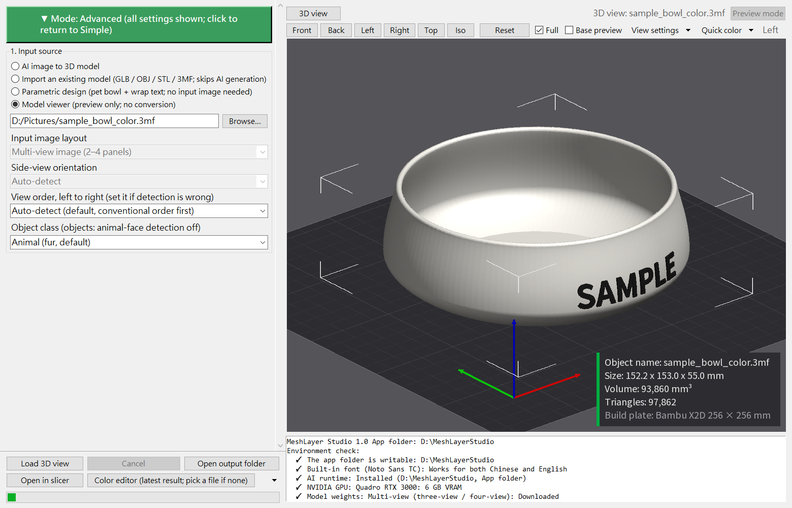
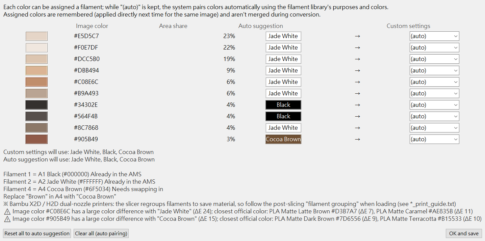
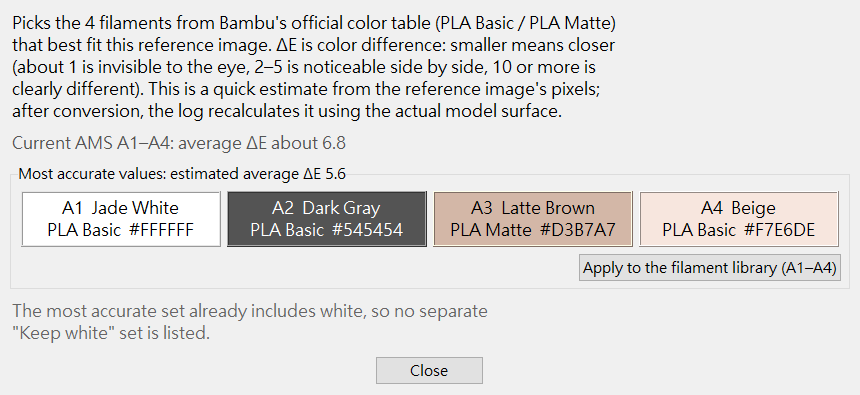
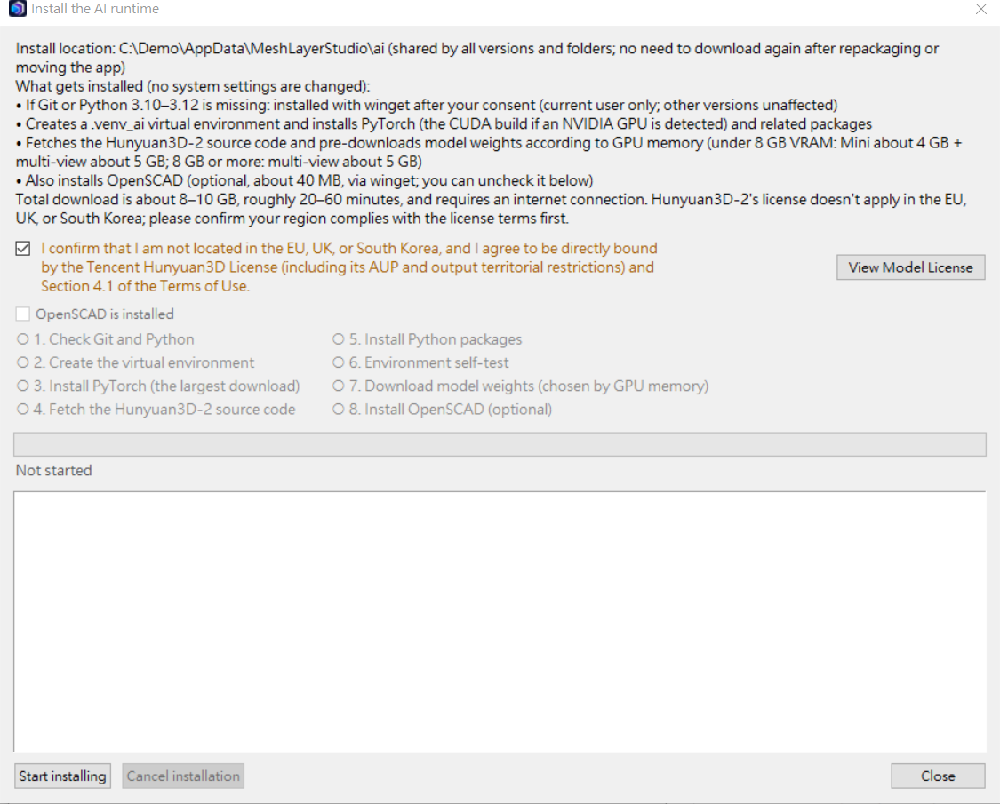
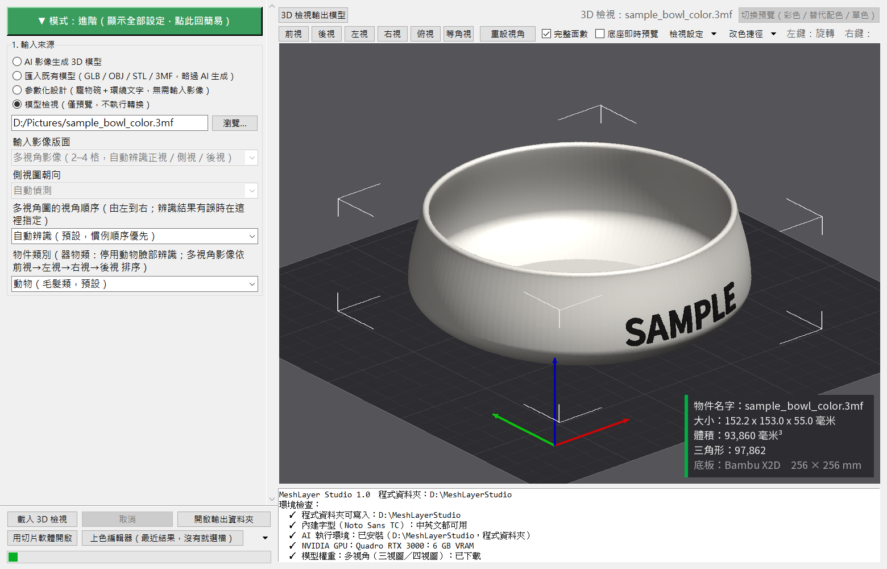
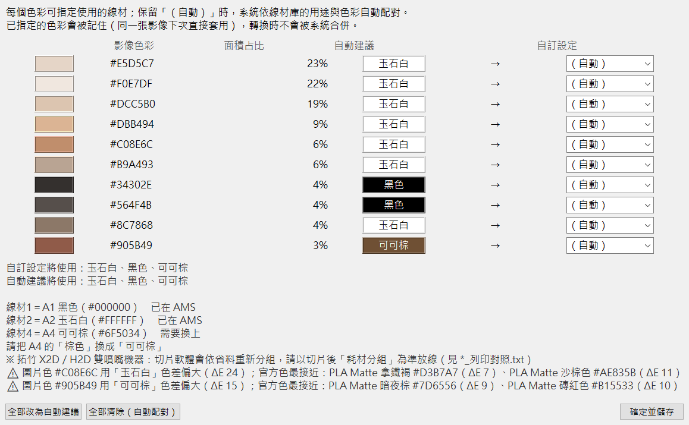
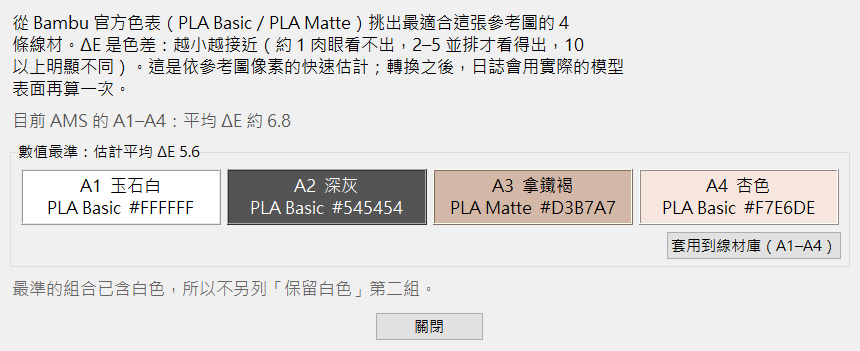
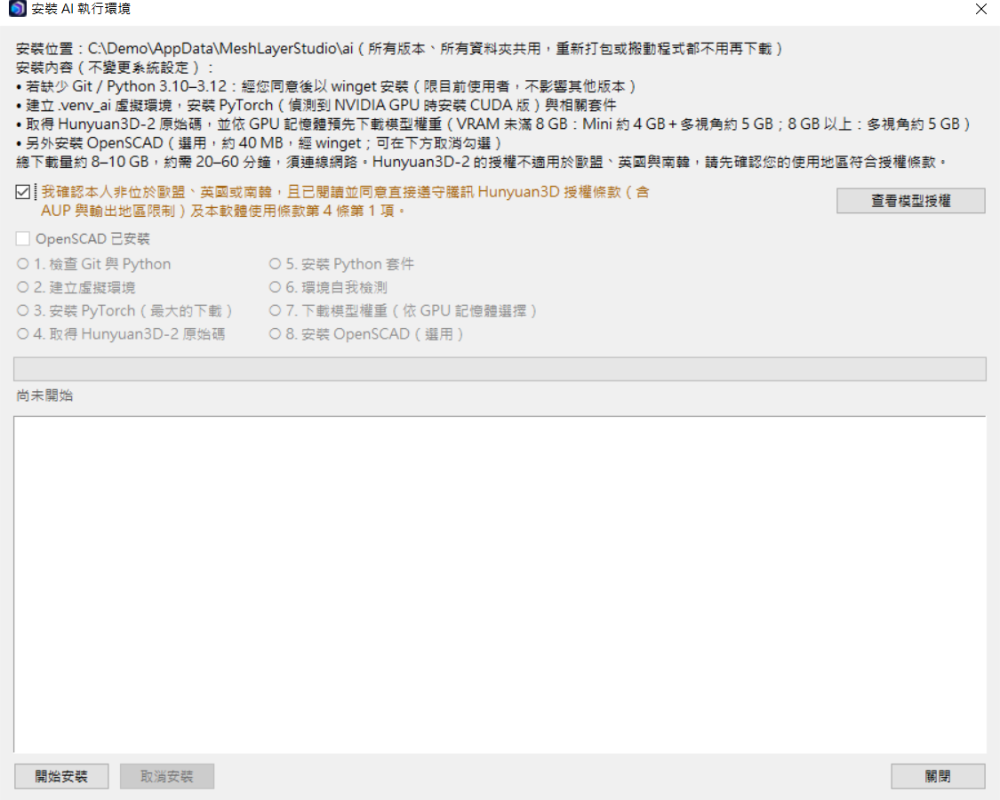

# MeshLayer Studio

**Turn an image or a 3D model into a print-ready STL and a multicolor 3MF — on your own computer.**
Free for Windows 10 / 11 (64-bit). No account, no telemetry, nothing is uploaded.

[**⬇ Download the latest release**](https://github.com/MeshLayerStudio-crypto/meshlayer-studio/releases/latest) ·
[Website](https://MeshLayerStudio-crypto.github.io/meshlayer-studio/) ·
[Terms of Use](TERMS_OF_USE.en.md) · [Privacy Policy](PRIVACY_POLICY.en.md) ·
[繁體中文說明](#繁體中文)

> **Version 1.0.** Please report problems in [Issues](https://github.com/MeshLayerStudio-crypto/meshlayer-studio/issues).

---

## What it does

- **Image → 3D (optional AI, runs locally).** Give it a photo or a multi-view picture; it builds a mesh with a local AI model, repairs holes, scales to your height, adds a base, and checks watertightness and thin walls.
- **Import a model** (GLB / OBJ / STL, for example from an online generator) and do the same clean-up, scaling and base.
- **Parametric designs:** customizable pet bowls, name plates, wrapped text, SVG patterns and logos, Gridfinity bins.
- **Multicolor 3MF:** map colors to the filaments you actually own (up to 24 AMS slots), edit colors in a built-in 3D editor, export a 3MF for Bambu Studio and other slicers.
- **Print checks:** wall thickness, watertightness, overhangs, small-feature warnings.
- **English and Traditional Chinese** interface.



| Color mapping | Best filament set | AI install (explicit confirmation) |
| :--- | :--- | :--- |
|  |  |  |

MeshLayer Studio works *before* slicing. It does not generate G-code or supports; open the exported STL / 3MF in your slicer.

## Download and first run

1. Download `MeshLayerStudio_1.0.8_win64.zip` from the [Releases](https://github.com/MeshLayerStudio-crypto/meshlayer-studio/releases/latest) page.
2. **Verify the file (recommended).** In PowerShell:
   ```powershell
   Get-FileHash .\MeshLayerStudio_1.0.8_win64.zip -Algorithm SHA256
   ```
   Compare the result with the SHA-256 shown on the release page.
3. Unzip to any folder (keep `MeshLayerStudio.exe` and the `_internal` folder together) and double-click `MeshLayerStudio.exe`.
4. If Windows shows *"Windows protected your PC"*: the program is not code-signed yet. Click **More info → Run anyway** only if the SHA-256 above matches.
5. If it says `VCRUNTIME140.dll` / `VCRUNTIME140_1.dll` / `MSVCP140.dll` is missing, or shows "Importing the numpy C-extensions failed" / "DLL load failed" (an older 2015–2017 Visual C++ runtime is not enough), double-click `Install_VC_Runtime.bat` (it opens Microsoft's official download page).

Image-to-3D with AI is **optional** and installed separately from inside the app ("Install the AI runtime…", about 8–10 GB of downloads, NVIDIA GPU with 6 GB or more recommended). Everything else works without it.

## Important limits

- **AI image-to-3D is not available in the European Union, the United Kingdom, or South Korea.** The AI models come from Tencent Hunyuan3D, whose license does not cover those regions (including the outputs). The app hides the AI feature when your system settings point there. All other features work everywhere.
- Windows 10 / 11, 64-bit. macOS is not supported at this time.
- Printed objects are **not certified food-safe** (pet bowls included) and may have small parts that are a choking hazard. Read the [Terms of Use](TERMS_OF_USE.en.md).

## Privacy in one paragraph

All images, models and settings stay on your computer. The app has no account system, analytics or crash reporting. It connects to the internet only when you click something that needs it (installing the AI runtime, downloading OpenSCAD or Gridfinity components, the Bambu filament color table, the Visual C++ runtime, or optional update checks, one for components and one for new program versions, both off by default; the version check only tells you and never downloads or installs anything). See the [Privacy Policy](PRIVACY_POLICY.en.md).

## License and notices

MeshLayer Studio is free software provided "as is"; the source code is not published. This repository contains only documentation and the website; the "Source code (zip / tar.gz)" links on the Release page are generated automatically by GitHub from these files and do not include the program's source code. The release package contains third-party components under their own licenses — see `THIRD_PARTY_NOTICES.txt` and the `licenses` folder. Independent project; not affiliated with, endorsed by, or sponsored by Bambu Lab. "Bambu Lab" and "Bambu Studio" are trademarks of their owners. The MeshLayer Studio name, logo and icons are all rights reserved and are not covered by any license to reuse them.

## Support the project

It is free and every feature works without paying. If it saves you time you can optionally [buy me a coffee on Ko-fi](https://ko-fi.com/meshlayerstudio). Supporting does not unlock anything. Contact: meshlayer.studio@gmail.com

---

# 繁體中文

**把圖片或 3D 模型，在你自己的電腦上轉成可列印的 STL 與多色 3MF。**
Windows 10／11（64 位元）免費使用。不用註冊、沒有遙測、不會上傳任何東西。

**版本 1.0.8。** 歡迎到 [Issues](https://github.com/MeshLayerStudio-crypto/meshlayer-studio/issues) 回報問題。

## 功能

- **圖片轉 3D（選用 AI，在本機執行）**：給一張照片或多視角圖，用本機 AI 模型生成網格，自動補洞、縮放到指定高度、加底座，並檢查水密性與過薄區域。
- **匯入既有模型**（GLB／OBJ／STL）：只做修補、縮放、加底座。
- **參數化設計**：可客製的寵物碗、名牌、環繞文字、SVG 圖樣與標誌、Gridfinity 收納盒。
- **多色 3MF**：依你實際擁有的線材配色（最多 24 個 AMS 槽位），內建 3D 編輯器可逐區改色，輸出給 Bambu Studio 等切片軟體。
- **列印前檢查**：壁厚、水密、懸垂、細小特徵提醒。
- **介面有繁體中文與英文。**



| 色彩對應 | 最佳線材組合 | 安裝 AI（需勾選確認） |
| :--- | :--- | :--- |
|  |  |  |

本軟體只做切片「之前」的工作，不產生 G-code 或支撐；請把輸出的 STL／3MF 交給切片軟體。

## 下載與第一次使用

1. 到 [Releases](https://github.com/MeshLayerStudio-crypto/meshlayer-studio/releases/latest) 下載 `MeshLayerStudio_1.0.8_win64.zip`。
2. **建議驗證檔案**，在 PowerShell 執行 `Get-FileHash .\MeshLayerStudio_1.0.8_win64.zip -Algorithm SHA256`，結果要和發布頁上的 SHA-256 相同。
3. 解壓縮到任一資料夾（`MeshLayerStudio.exe` 與 `_internal` 資料夾要放在一起），雙擊 `MeshLayerStudio.exe`。
4. 若 Windows 顯示「Windows 已保護您的電腦」：本程式目前尚未做程式碼簽章；**確認 SHA-256 相符後**，點「其他資訊 → 仍要執行」。
5. 若提示找不到 `VCRUNTIME140.dll`／`VCRUNTIME140_1.dll`／`MSVCP140.dll`，或出現「Importing the numpy C-extensions failed」「DLL load failed」（舊版 2015–2017 執行庫不夠），雙擊 `Install_VC_Runtime.bat`（會開啟 Microsoft 官方下載頁）。

AI 圖片轉 3D 是**選用功能**，要在程式內另外安裝（「安裝 AI 執行環境…」，約 8–10 GB 下載，建議 6 GB 以上 NVIDIA 顯示卡）。不裝 AI 也能使用其他所有功能。

## 重要限制

- **AI 圖片轉 3D 在歐盟、英國、南韓不提供**：AI 模型來自騰訊 Hunyuan3D，其授權不涵蓋這些地區（含輸出）。系統設定指向這些地區時，程式會隱藏 AI 功能；其他功能在各地都能用。
- 目前只有 Windows 10／11 64 位元版本，**目前不支援 macOS**。
- 列印成品**未經食品接觸認證**（包含寵物碗），也可能有細小零件造成窒息風險。請閱讀[使用條款](TERMS_OF_USE.md)。

## 隱私

圖片、模型與設定都留在你的電腦。沒有帳號、使用分析或當機回報。只有你主動點了需要連網的功能才會連線（安裝 AI 環境、下載 OpenSCAD／Gridfinity 元件、Bambu 色表、Visual C++ 執行庫，或預設關閉的元件更新檢查與程式新版本通知；新版本通知只提醒你，不會自動下載或安裝）。詳見[隱私權政策](PRIVACY_POLICY.md)。

## 授權與聲明

免費軟體，依「現況」提供，不公開原始碼。本 repo 只有文件與網頁；Release 頁面的「Source code (zip／tar.gz)」是 GitHub 自動產生的，內容就是這些文件，不含程式原始碼。發布包內含第三方元件，各依其授權，見 `THIRD_PARTY_NOTICES.txt` 與 `licenses` 資料夾。本專案為獨立開發，與 Bambu Lab 無隸屬、授權、贊助或背書關係；「Bambu Lab」「Bambu Studio」為其所有人之商標。MeshLayer Studio 名稱、標誌與圖示保留所有權利，不含任何再使用授權。

## 贊助

軟體免費，所有功能不需付費。若這個工具幫你省了時間，歡迎到 [Ko-fi 請我喝杯咖啡](https://ko-fi.com/meshlayerstudio)，贊助不會解鎖任何功能。聯絡：meshlayer.studio@gmail.com
